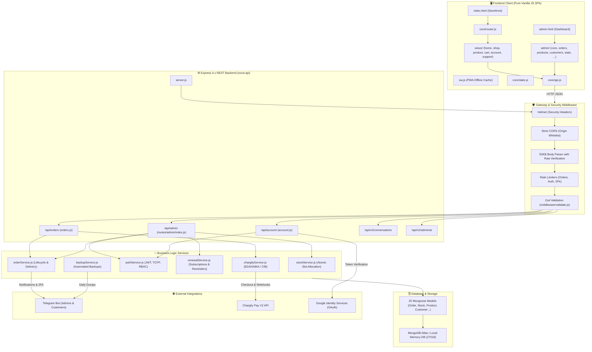

# 📘 وثيقة تسليم المشروع والتوثيق التقني الشامل (PROJECT HANDOVER)
# OVIRA PLAY — Smart Arabic Digital Subscription Platform

> **تاريخ التوثيق:** 20 نوفمبر 2026  
> **الإصدار الحالي:** 1.0.0 (Foundation & Architecture Hardened)  
> **حالة النظام:** مستقر وجاهز للتشغيل المحلي والإنتاج (All Contract & Offline Tests Passing: 100%)  
> **الهدف:** تمكين مطور / مهندس الذكاء الاصطناعي الجديد من استيعاب المشروع بالكامل، إدارته، صيانته، واختباره، وتطويره بأعلى معايير الجودة والأمان دون المساس بأي ميزة سابقة.

---

## 📑 جدول المحتويات (Table of Contents)

1. [نظرة عامة على المشروع (Project Overview)](#1-نظرة-عامة-على-المشروع-project-overview)
2. [معمارية المشروع التفصيلية (Complete Project Architecture)](#2-معمارية-المشروع-التفصيلية-complete-project-architecture)
3. [الميزات الحالية ونطاق العمل (Existing Features & Scope)](#3-الميزات-الحالية-ونطاق-العمل-existing-features--scope)
4. [تاريخ التطوير والقرارات الهندسية (Development History & Technical Decisions)](#4-تاريخ-التطوير-والقرارات-الهندسية-development-history--technical-decisions)
5. [الإعداد، التشغيل، والنشر (Configuration & Deployment)](#5-الإعداد-التشغيل-والنشر-configuration--deployment)
6. [التدقيق التقني وجودة الكود (Code Quality & Technical Audit)](#6-التدقيق-التقني-وجودة-الكود-code-quality--technical-audit)
7. [الحالة الراهنة للمشروع (Current Project Status)](#7-الحالة-الراهنة-للمشروع-current-project-status)
8. [خارطة الطريق المستقبلية (Development Roadmap)](#8-خارطة-الطريق-المستقبلية-development-roadmap)
9. [دليل التطوير الآمن للأجهزة الذكية (Safe AI Development Guidelines)](#9-دليل-التطوير-الآمن-للأجهزة-الذكية-safe-ai-development-guidelines)

---

## 1. نظرة عامة على المشروع (Project Overview)

### 1.1 اسم المشروع والغرض الأساسي
- **الاسم التجاري والتقني:** **OVIRA PLAY** (متجر الاشتراكات الرقمية الذكي).
- **الغرض:** منصة تجارة إلكترونية متخصصة في بيع وتوزيع وتجديد الاشتراكات الرقمية والخدمات السحابية بالدينار الجزائري (DZD)، مثل:
  - خدمات البث الترفيهي: Netflix, Shahid VIP, TOD, OSN+, Crunchyroll, YouTube Premium, Disney+.
  - الخدمات الإنتاجية والذكاء الاصطناعي: ChatGPT Plus, Canva Pro, Microsoft 365, Spotify, Duolingo.
- **الجمهور المستهدف:** 
  1. **المستهلك النهائي (B2C):** الزبائن الجزائريون والعرب الباحثون عن اشتراكات رقمية بأسعار معقولة ووسائل دفع محلية متوفرة بسهولة (BaridiMob, CCP, بطاقة الذهبية / CIB، والمحافظ الإلكترونية).
  2. **فريق الإدارة والدعم (Store Ops):** مالكو المتجر، موظفو خدمة العملاء، ومسؤولو التسليم وإدارة المخزون.

### 1.2 ما يفعله التطبيق حالياً
1. **واجهة متجر عصرية بالكامل باللغة العربية (RTL):** استعراض المنتجات والباقات، تصفية بالتصنيفات، بحث فوري مع Debounce، صفحات هبوط متخصصة لكل منتج، مراجعات حقيقية موثقة، وسلة تسوق متعددة الخطوات.
2. **بوابة زبائن متكاملة (Customer Portal):** تسجيل دخول بالبريد أو الهاتف أو Google One-Tap أو عبر بوت Telegram، دعم التحقق الثنائي (2FA TOTP & Telegram OTP)، تتبع الطلبات الحية، ومركز إشعارات مدمج.
3. **لوحة تحكم إدارية شاملة (Admin Control Panel):** إدارة الطلبات، إنشاء طلبات يدوية مع منع التكرار، جدولة المواعيد والتسليم، تخصيص وإدارة حسابات وشاشات المخزون (Stock & Slots)، محرر متقدم للكتالوج والباقات مع سجل تراجعات (Revision History)، محفظة العملاء والشكاوى، ومحادثات الدعم المباشر.
4. **تكاملات الأتمتة والدفع:** تكامل بوابة Chargily Pay للدفع بالبطاقة الذهبية، بوت Telegram إداري للإشعارات والتنبيهات ورموز المصادقة والنسخ الاحتياطي اليومي، وخدمة تجديد الاشتراكات التلقائية.

### 1.3 مرحلة التطوير الحالية
- **المرحلة:** مرحلة النضج المعماري (Production-Grade Architecture).
- **الإنجازات المكتملة حديثاً:**
  - توحيد مصدر الشيفرة البرمجية وتجميد التكرارات السابقة في `projects_ARCHIVED/`.
  - تجزئة ملفات JavaScript الضخمة إلى وحدات نظيفة متخصصة في الواجهة الأمامية ولوحة الإدارة.
  - تجزئة مسارات الإدارة في الواجهة الخلفية إلى 8 وحدات تابعة (`routes/admin/*`).
  - تطبيق طبقة التحقق من المدخلات الصارمة بواسطة مكتبة Zod (`middleware/validate.js`).
  - اجتياز اختبارات الأمان والتعاقدات بنسبة 100% بدون أي إخفاق.

---

## 2. معمارية المشروع التفصيلية (Complete Project Architecture)

### 2.1 شجرة المجلدات والملفات (Filesystem Layout)

```
d:/WebStudio/
├── OVIRA-LOCAL-DEV/                      # 🌟 مجلد التطوير النشط الوحيد المعتمد
│   ├── OVIRAPLAY-main/                  # 🖥️ تطبيق الواجهة الأمامية (SPA)
│   │   ├── index.html                   # صفحة المتجر الرئيسية (RTL, Skeleton UI)
│   │   ├── admin.html                   # صفحة لوحة التحكم الإدارية
│   │   ├── app.js                       # مدخل الواجهة الأمامية وربط الأحداث
│   │   ├── admin.js                     # مدخل وتنسيق لوحة الإدارة
│   │   ├── ovira-core.css               # متغيرات التصميم والأساسيات (Design Tokens + V4)
│   │   ├── ovira-experience.css         # طبقة الأنماط التفاعلية والخطوط
│   │   ├── style.css                    # أنماط ومكونات المتجر الكلاسيكية
│   │   ├── admin.css                    # أنماط لوحة الإدارة
│   │   ├── sw.js                        # Service Worker للتخزين المؤقت والـ PWA
│   │   ├── pwa.js                       # تسجيل الـ PWA ومعالجة التثبيت
│   │   ├── manifest.json                # بيانات تطبيق الويب التقدمي
│   │   ├── offline.html                 # صفحة العمل عند انقطاع الإنترنت
│   │   ├── core/                        # النواة البرمجية للمتجر
│   │   │   ├── api.js                   # طبقة الاتصال بـ Backend API
│   │   │   ├── router.js                # نظام التوجيه بالهاش (Hash Router)
│   │   │   ├── state.js                 # إدارة الحالة المشتركة (Store State)
│   │   │   └── utils.js                 # دوال التنسيق، الهروب من XSS، والـ Debounce
│   │   ├── views/                       # واجهات الصفحات المستقلة
│   │   │   ├── home.js                  # الصفحة الرئيسية والعروض
│   │   │   ├── shop.js                  # الكتالوج، الفلاتر، والبحث
│   │   │   ├── product.js               # تفاصيل المنتج، المراجعات، والباقات
│   │   │   ├── cart.js                  # السلة والشراء متعدد الخطوات
│   │   │   ├── account.js               # مركز العميل، 2FA، والمصادقة
│   │   │   └── support.js               # صفحة الدعم والمحادثات
│   │   ├── components/                  # المكونات العامة المشتركة
│   │   │   ├── header.js                # الترويسة وشريط التنقل العلوي
│   │   │   └── footer.js                # التذييل والصفحات القانونية
│   │   ├── admin/                       # وحدات لوحة التحكم المقسمة
│   │   │   ├── core.js                  # تسجيل الدخول، الجلسات، والشيل الإداري
│   │   │   ├── orders.js                # إدارة الطلبات، التسليم، وإنشاء الطلب اليدوي
│   │   │   ├── products.js              # إدارة المنتجات، الباقات، والمراجعات
│   │   │   ├── customers.js             # سجل العملاء، الشكاوى، والمحافظ
│   │   │   ├── stats.js                 # الإحصائيات، التجديدات، والمالية
│   │   │   ├── messages.js              # إدارة الرسائل والمحادثات
│   │   │   ├── notifications.js         # الحملات والإشعارات
│   │   │   ├── ai-control.js            # إعدادات وتحكم الذكاء الاصطناعي
│   │   │   ├── engagement.js            # تفاعل الزوار والتحليلات
│   │   │   ├── historical-finance.js    # المبيعات التاريخية والأرشيف
│   │   │   └── admin-layout.css         # أنماط شيل الإدارة والقوائم الجانبية
│   │   └── assets/                      # الخطوط المحلية (Noto Sans Arabic)، الشعارات، والأيقونات
│   │
│   ├── ovira-api-main/                  # ⚙️ خادم الواجهة الخلفية (Backend API)
│   │   ├── server.js                    # نقطة انطلاق Express، إعداد الأمان، والاتصال بالـ DB
│   │   ├── local-dev.js                 # سكريبت بيئة التطوير المحلية المعزولة (Memory Mongo)
│   │   ├── package.json                 # الحزم والتبعيات وأوامر الاختبار
│   │   ├── routes/                      # مسارات الـ REST API
│   │   │   ├── orders.js                # طلبات الشراء، الكتالوج، ومسار Chargily Webhook
│   │   │   ├── account.js               # تسجيل حسابات الزبائن، الجلسات، والمصادقة
│   │   │   ├── admin.js                 # مدخل مسارات الإدارة ومصادقة المشرفين
│   │   │   ├── admin/                   # مسارات الإدارة المقسمة معمارياً (Phase 3)
│   │   │   │   ├── index.js             # مجمع المسارات الإدارية
│   │   │   │   ├── middlewares.js       # وسائط الحماية، RBAC، والتدقيق الأمني
│   │   │   │   ├── auth.js              # تسجيل دخول الإدارة، 2FA، والجلسات
│   │   │   │   ├── orders.js            # عمليات الطلبات، الطلبات اليدوية، والجدولة
│   │   │   │   ├── stock.js             # إدارة الحسابات، الشاشات، والتوزيع الذري
│   │   │   │   ├── products.js          # CRUD المنتجات وسجل النسخ والتراجع
│   │   │   │   ├── customers.js         # إدارة الزبائن، الشكاوى، والمراجعات
│   │   │   │   └── stats.js             # لوحة المؤشرات، التجديدات، وطرق الدفع
│   │   │   ├── conversations.js         # محادثات الدعم الفني للزبائن
│   │   │   ├── adminConversations.js    # إدارة المحادثات للمشرفين
│   │   │   ├── aiControl.js             # بوابات التحكم بخدمات الذكاء الاصطناعي
│   │   │   ├── agent.js                 # واجهة وكلاء الأتمتة المعتمدين
│   │   │   ├── whatsapp.js              # استقبال وإرسال ويب هوك واتساب
│   │   │   ├── siteNotifications.js     # إشعارات الزوار والعملاء
│   │   │   ├── publicAnnouncements.js   # الإعلانات الشريطية العامة
│   │   │   ├── security.js              # الإعدادات الأمنية المتقدمة للمالك
│   │   │   ├── historicalSales.js       # إدخال واستعلام المبيعات السابقة
│   │   │   └── financeRead.js           # تقارير الأرباح والمبيعات
│   │   ├── models/                      # 25 نموذج Mongoose لقاعدة البيانات
│   │   │   ├── Order.js                 # الطلب، الحالات، بيانات الدفع، والتسليم
│   │   │   ├── Stock.js                 # مخزون الحسابات والشاشات وتواريخ الصلاحية
│   │   │   ├── Product.js               # المنتجات، الخطط، المزايا، والـ FAQ
│   │   │   ├── Customer.js              # حسابات الزبائن، الأرصدة، وبيانات الاتصال
│   │   │   ├── Admin.js                 # حسابات المشرفين، الأدوار (RBAC)، و 2FA
│   │   │   ├── Conversation.js          # جلسات المحادثة والدعم
│   │   │   ├── ConversationMessage.js   # الرسائل الفردية ومصادرها
│   │   │   ├── Audit.js                 # سجل تدقيق عمليات المشرفين
│   │   │   ├── Complaint.js             # شكاوى الزبائن وتتبعها
│   │   │   ├── Coupon.js                # قسائم الخصم وشروطها
│   │   │   ├── Review.js                # تقييمات المنتجات واعتمادها
│   │   │   ├── Setting.js               # إعدادات النظام وطرق الدفع
│   │   │   ├── ProductRevision.js       # سجل تراجعات المنتجات
│   │   │   └── ...                      # بقية النماذج المتخصصة
│   │   ├── services/                    # طبقة منطق الأعمال (Business Logic)
│   │   │   ├── orderService.js          # تغيير حالات الطلبات وإشعارات التسليم
│   │   │   ├── stockService.js          # التخصيص الذري لشاشات المخزون
│   │   │   ├── chargilyService.js       # معالجة جلسات وتواقيع الدفع الإلكتروني
│   │   │   ├── authService.js           # توليد والتحقق من رموز TOTP و JWT
│   │   │   ├── renewalService.js        # جدولة وحساب تذكيرات التجديد
│   │   │   ├── backupService.js         # إنشاء نسخ احتياطية وإرسالها عبر Telegram
│   │   │   ├── productService.js        # تنسيق وحساب أسعار الباقات
│   │   │   ├── conversationService.js   # إدارة محادثات الدعم
│   │   │   └── limiters.js              # محددات معدل الطلبات (Rate Limiters)
│   │   ├── middleware/                  # وسائط معالجة الطلبات
│   │   │   └── validate.js              # التحقق من صحة المدخلات عبر Zod
│   │   ├── bot/                         # بوت تليغرام
│   │   │   └── telegram.js              # معالجة أوامر تليغرام والإشعارات التلقائية
│   │   ├── tests/                       # اختبارات الأمان والتعاقدات (15 ملف اختبار)
│   │   └── scripts/                     # سكريبتات الصيانة وفحص الأمان والتهجير
│   │
│   ├── .claude/skills/                  # تعليمات ومعايير التطوير الصارمة
│   │   ├── ovira-security-isolation/    # معايير العزل والأمان
│   │   ├── ovira-anti-hallucination/    # منع البيانات الوهمية والتأكد من العقود
│   │   ├── ovira-arabic-typography/     # معايير الخطوط العربية والطباعة
│   │   ├── ovira-minimal-rtl/           # معايير تجربة المستخدم RTL
│   │   └── ovira-perf-a11y/             # معايير الأداء وإمكانية الوصول
│   ├── backups/                         # نسخ احتياطية قبل التعديلات الكبيرة
│   ├── .editorconfig                    # ضبط تنسيق المسافات والترميز
│   ├── eslint.config.js                 # قواعد فحص جودة الكود
│   ├── CLAUDE.md                        # دستور التطوير الإلزامي للمشروع
│   ├── API-DOCS.md                      # توثيق كافة مسارات الـ API بالتفصيل
│   ├── ROLES.md                         # تفصيل نظام الصلاحيات والأدوار (RBAC)
│   └── README.md                        # دليل البدء السريع
│
├── projects_ARCHIVED/                   # 🗄️ أرشيف النسخ السابقة المجمدة (للقراءة فقط)
├── templates/                           # قوالب مساعدة
├── MASTER_DEVELOPMENT_PLAN.md           # خارطة الطريق الكبرى المعتمدة
└── README.md                            # التوثيق التعريفي العام لمساحة العمل
```

---

### 2.2 البنية التقنية ومخطط تدفق البيانات (Architecture Diagram)



---

### 2.3 اللغات والمكتبات والتبعيات (Tech Stack & Dependencies)

#### الواجهة الأمامية (Frontend):
- **اللغات:** HTML5 الدلالي، CSS3 الحديث (CSS Custom Properties / Design Tokens)، و Vanilla JavaScript (ES6+).
- **الخطوط:** خطوط `Noto Sans Arabic` (مستضافة محلياً داخل `assets/fonts/`، بدون أي تبعية لخطوط Google الخارجية لمنع حظر العرض).
- **المكتبات:** تطبيق بدون أي أطر عمل خارجية (Zero Framework). يتم استخدام مكتبة Google One-Tap الخارجية فقط للمصادقة السريعة.
- **التخزين المؤقت وتطبيقات الويب:** PWA Service Worker كامل التوافق (`sw.js`).

#### الواجهة الخلفية (Backend):
- **بيئة التشغيل:** Node.js (الإصدار `>= 18.0.0`).
- **إطار العمل:** Express.js `^4.19.2`.
- **قاعدة البيانات ونمذجة الكائنات:** Mongoose `^8.4.0` (متصل بـ MongoDB Atlas أو MongoDB محلي).
- **التحقق من البيانات (Validation):** Zod `^4.6.7` (تم دمجه في `middleware/validate.js`).
- **الأمان والتشفير:**
  - `helmet`: حماية الرؤوس وتأمين الاتصالات (`^7.1.0`).
  - `cors`: تقييد النطاقات المصرح لها فقط (`^2.8.5`).
  - `jsonwebtoken`: إدارة جلسات الزبائن والمشرفين عبر JWT (`^9.0.2`).
  - `bcryptjs`: تشفير وتجزئة كلمات المرور بأمان (`^2.4.3`).
  - `express-rate-limit`: محددات معدل الطلب لمنع هجمات الحرمان والقوة الغاشمة (`^7.3.1`).
- **بوت التليغرام:** Telegraf `^4.16.3`.
- **بيئة التطوير المحلية:** `mongodb-memory-server` `^11.3.0` مع محرك تخزين `wiredTiger` على المنفذ `27018`.

---

### 2.4 هيكل ونماذج قاعدة البيانات (Database Architecture & Schemas)

تحتوي قاعدة البيانات على 25 نموذجاً من خلال Mongoose. أهم النماذج المركزية وعلاقاتها:

#### 1. نموذج الطلب (`Order` - `models/Order.js`)
يمثل حجر الزاوية في عمليات البيع والتسليم:
- `orderCode`: كود فريد يبدأ بـ `OP-` أو `OP-M` (للطلبات اليدوية). مفهرس وفريد.
- `customerName` & `whatsappNumber`: اسم الزبون ورقم هاتفه (إلزامي).
- `customerEmail`: البريد الإلكتروني (اختياري، للربط والإشعارات).
- `cartItems`: مصفوفة المنتجات والباقات المطلوبة (المنتج، الباقة، المدة بالشهور، الكمية، السعر).
- `totalPrice` & `subTotal` & `discountAmount` & `couponCode`: الحسابات المالية والقسائم.
- `paymentMethod`: طريقة الدفع المختارة (Chargily, بريدي موب, رصيد المحفظة, إلخ).
- `status`: حالة الطلب (`قيد المراجعة`, `مؤكد`, `تم التسليم`, `ملغي`).
- `deliveryState`: دورة حياة التسليم المتقدمة (`pending_payment`, `ready_to_deliver`, `stock_reserved`, `delivered`, `cancelled`).
- `allocatedSlots`: مصفوفة الشاشات المخصصة من المخزون مع معرف الحساب ورقم البروفايل وتاريخ التعيين.
- `requestedAt` & `scheduledFor` & `timezone` & `scheduleNote`: حقول جدولة التنفيذ المتفق عليه مع الزبون.
- `deliveredAccount`: تفاصيل التسليم المرسلة (نوع التسليم: `screen`, `account`, `invite`، بيانات الحساب، الرابط، اسم البروفايل، رمز الـ PIN).
- `customerId`: معرف العميل المرتبط (`ref: 'Customer'`).
- `chargilyCheckoutId` & `isPaidOnline` & `paymentDetails`: تفاصيل الدفع الإلكتروني الموثق.

#### 2. نموذج المخزون والشاشات (`Stock` - `models/Stock.js`)
يمثل الحسابات الرئيسية المشتركة التي يتم توزيع شاشاتها على الزبائن:
- `code`: معرف فريد لحساب المخزون.
- `productId` & `productName`: المنتج المرتبط (مثل `netflix`, `spotify`).
- `email` & `password`: بيانات الدخول للحساب الرئيسي.
- `costPrice`: تكلفة الحساب على المتجر.
- `masterExpiresAt`: تاريخ انتهاء الحساب الرئيسي لدى المزود.
- `slots`: مصفوفة الشاشات المتاحة داخل الحساب:
  - `slotNumber`: رقم الشاشة (1، 2، 3...).
  - `profileName`: اسم البروفايل المخصص.
  - `pin`: الرمز السري للشاشة (PIN code).
  - `status`: حالة الشاشة (`available` أو `occupied`).
  - `orderId` & `orderCode`: ربط الشاشة بالطلب المخصص له.
  - `customerName` & `customerPhone`: بيانات العميل المستخدم للشاشة.
  - `expiresAt`: تاريخ انتهاء صلاحية اشتراك هذه الشاشة تحديداً.

#### 3. نموذج المنتج والكتالوج (`Product` - `models/Product.js`)
يمثل بطاقات الكتالوج وصفحات الهبوط:
- `productId`: معرف نصي فريد (مثل `netflix`, `chatgpt`).
- `brandName` & `title` & `subtitle`: العناوين والماركة باللغة العربية.
- `category`: تصنيف المنتج (`أفلام ومسلسلات`, `موسيقى`, `إنتاجية`, `ألعاب`...).
- `primaryColor` & `secondaryColor`: ألوان الهوية البصرية للبطاقة والصفحة.
- `plans`: مصفوفة الباقات المتاحة (المدة بالشهور، السعر، تمييز الباقة الأكثر توفيراً `best`، ووصف الباقة).
- `features` & `steps` & `faqs` & `guaranteeText`: محتوى صفحة الهبوط المقنعة للمشتري.
- `active` & `sortOrder`: حالة النشر والترتيب.

#### 4. نموذج العميل (`Customer` - `models/Customer.js`)
- `name`, `email`, `phone`, `whatsapp`: بيانات الاتصال الأساسية وحالات توثيقها.
- `passwordHash`: كلمة المرور المشفرة بـ bcrypt.
- `telegramChatId` & `telegramUsername`: ربط حساب الموقع بحساب تليغرام.
- `balance`: رصيد المحفظة الرقمية داخل المتجر.
- `twoFactorEnabled` & `twoFactorSecret` & `twoFactorMethod`: إعدادات التحقق الثنائي.
- `ordersCount` & `totalSpent`: إحصائيات مشتريات العميل.

#### 5. نموذج المشرف (`Admin` - `models/Admin.js`)
- `email` & `passwordHash`: بيانات الدخول.
- `role`: الدور الصلاحي (`owner`, `staff`, `viewer`).
- `telegramId`: معرف تليغرام للمصادقة وتلقي الإشعارات الحرجة.
- `failedLoginAttempts` & `lockUntil`: الحماية ضد محاولات التخمين.
- `tokenVersion`: لإلغاء جميع الجلسات النشطة عند تغيير كلمة المرور.

---

### 2.5 نظام الصلاحيات والأدوار (Role-Based Access Control - RBAC)

يعتمد النظام على فصل صارم للمسؤوليات، مبيّن في الجدول التالي وموثق في [ROLES.md](file:///d:/WebStudio/OVIRA-LOCAL-DEV/ROLES.md):

| الإجراء / المجال | المالك (`owner`) | الموظف (`staff`) | المشاهد (`viewer`) |
| :--- | :---: | :---: | :---: |
| **لوحة التحكم والمؤشرات** | ✅ كاملة | ✅ كاملة | ✅ قراءة فقط |
| **سجل التدقيق الأمني (Audit Log)** | ✅ كاملة | ❌ محظور | ❌ محظور |
| **إنشاء وتعديل الطلبات والجدولة** | ✅ كاملة | ✅ كاملة | ❌ قراءة فقط |
| **تسليم الحسابات وإصدار الرموز المؤقتة** | ✅ كاملة | ✅ كاملة | ❌ محظور |
| **حذف الطلبات نهائياً** | ✅ حصري | ❌ محظور | ❌ محظور |
| **ربط الزبائن بالطلبات القديمة** | ✅ حصري (مع Step-Up Auth) | ❌ محظور | ❌ محظور |
| **إدارة المخزون وتعيين الشاشات** | ✅ كاملة | ✅ كاملة | ❌ قراءة فقط |
| **إدارة المنتجات والباقات** | ✅ كاملة | ✅ كاملة | ❌ قراءة فقط |
| **حذف المنتجات وسجل النسخ والتراجع** | ✅ حصري | ❌ محظور | ❌ محظور |
| **إدارة طرق الدفع والأسرار وتكوين Chargily**| ✅ حصري | ❌ محظور | ❌ محظور |
| **إعدادات وتحكم الذكاء الاصطناعي (Kill Switch)**| ✅ حصري | ❌ محظور | ❌ محظور |
| **المبيعات التاريخية والأمور المالية** | ✅ حصري | ❌ محظور | ❌ محظور |

---

## 3. الميزات الحالية ونطاق العمل (Existing Features & Scope)

### 3.1 الميزات المكتملة وتعمل بنسبة 100% (Fully Working)
1. **واجهة المتجر والكتالوج:**
   - عرض فوري للمنتجات النشطة مع أسعار الباقات المحدثة.
   - تصفية متقدمة حسب الفئات وتصنيف المشتريات.
   - بحث لحظي مزود بخاصية الـ Debounce (300ms) لمنع إرهاق الواجهة.
   - عرض مراجعات الزبائن المعتمدة فقط مع متوسط التقييمات.
   - صفحات هبوط مخصصة لكل منتج تحتوي على الأسئلة الشائعة وضمان الخدمة.
2. **سلة المشتريات والطلب (Checkout Experience):**
   - سلة تفاعلية مع حفظ محلي في المتصفح (`LocalStorage`).
   - تدفق شراء متعدد الخطوات (مراجعة السلة → بيانات العميل والواتساب → اختيار طريقة الدفع → تأكيد الطلب).
   - تطبيق قسائم الخصم وحساب الخصم تلقائياً.
   - دعم الدفع بالبطاقة الذهبية / CIB عبر بوابة Chargily Pay الرسمية مع التحقق الآمن عبر الويب هوك.
   - دعم الدفع اليدوي (بريدي موب / CCP) مع تعليمات واضحة وتأكيد غير تلقائي لحماية المتجر.
3. **حساب الزبون ومصادقة الهوية:**
   - تسجيل الدخول التقليدي بالبريد الإلكتروني / الهاتف وكلمة المرور.
   - تسجيل الدخول بضغطة زر عبر حساب Google One-Tap.
   - تسجيل الدخول والربط التلقائي عبر بوت تليغرام.
   - التحقق الثنائي عبر تطبيقات TOTP أو رسائل OTP في تليغرام.
   - تتبع فوري لحالة الطلبات ومراجعة تفاصيل الحسابات المسلمة بأمان.
   - تقديم شكاوى على الطلبات وتتبع رد المشرفين.
4. **لوحة التحكم الإدارية (Admin Panel):**
   - واجهة مستجيبة بالكامل على الحواسيب والهواتف الذكية مع شريط جانبي وقوائم منظمة.
   - تصفية الطلبات حسب الحالات (قيد المراجعة، مؤكد، تم التسليم، ملغي، والطلبات المجدولة).
   - **إنشاء طلب يدوي (`POST /api/admin/orders/manual`)** يتيح للمشرف إدخال طلبات الزبائن الواردة عبر الهاتف أو المحادثات مباشرة مع ميزة منع التكرار (Idempotency).
   - **جدولة الطلبات (`scheduledFor` & `requestedAt`)** لضبط مواعيد التسليم المسبقة.
   - **نظام تسليم الحسابات الآمن** مع خيار التعيين التلقائي لشاشة متاحة من المخزون وتحديث حالة الطلب وإشعار الزبون.
   - **إصدار رموز الدخول المؤقتة (Temporary Codes)** وإرسالها فوراً إلى حساب تليغرام الموثق للزبون.
   - **ربط الطلبات بالحسابات (`/link-customer`)** مع تحقق إضافي عبر كلمة سر المالك ورمز 2FA وسجل تدقيق تفصيلي.
   - **إدارة المخزون والشاشات** وتتبع الشاشات الشاغرة وتواريخ انتهاء الصلاحية لكل حساب.
   - **محرر الباقات الذكي وسجل النسخ السابقة (Revision History)** وإمكانية التراجع عن أي تعديل للمنتجات.
   - **صندوق محادثات الدعم الفني** الموحد وتتبع الرسائل غير المقروءة.
   - **إحصائيات المبيعات، تقويم التجديدات القادمة، وسجل التدقيق الأمني.**
5. **الأتمتة والخدمات الخلفية:**
   - بوت Telegram الإداري: إرسال تنبيهات فورية بالطلبات الجديدة، الرد على الأوامر، وتأكيد عمليات الدخول.
   - النسخ الاحتياطي التلقائي اليومي وإرسال النسخة عبر تليغرام.
   - تذكيرات تجديد الاشتراكات قبل انتهائها بفترات محددة.

### 3.2 ميزات قيد التطوير جزئياً (Partially Implemented)
1. **أتمتة رسائل واتساب:** هيكل استقبال الويب هوك والتحقق من التوقيع HMAC مدمج في `routes/whatsapp.js`، ولكن إرسال الرسائل الحية معطل في بيئة التطوير المحلية ويحتاج مفاتيح Meta API الرسمية في الإنتاج.
2. **المحادثات اللحظية عبر WebSockets / SSE:** المحادثات الحالية تعمل عبر استدعاءات API والتحديث الدوري؛ تحويلها إلى تقنية Real-time WebSocket مخطط له في المرحلة السابعة.
3. **التشفير غير المتماثل لكلمات مرور المخزون:** بيانات الحسابات في نموذج المخزون مخزنة حالياً كنص مشفر بسيط؛ تحويلها إلى تشفير AES-256-GCM مع مفتاح بيئي منفصل مدرج في المرحلة الرابعة.

### 3.3 ميزات مخططة للمستقبل (Planned Features)
- إشعارات Push Notifications عبر الـ Service Worker للمتصفح.
- نظام كوبونات متقدم يدعم تقييد الكوبون بمنتجات معينة أو حد أدنى للطلب.
- دعم تعدد اللغات (إضافة اللغة الفرنسية للسوق الجزائري إلى جانب العربية).
- إنشاء صفحات Pre-rendered / SSR للمنتجات لتحسين أرشفة محركات البحث (SEO).

---

## 4. تاريخ التطوير والقرارات الهندسية (Development History & Technical Decisions)

### 4.1 قرارات معمارية استراتيجية (Architectural Decisions)
1. **الاعتماد الصارم على Vanilla JS الخالصة:**
   - *القرار:* عدم إقحام React أو Vue أو أطر عمل ضخمة في الواجهة الأمامية.
   - *السبب:* الحفاظ على سرعة تحميل فائقة على شبكات الجيل الثالث وضعيفة النطاق (3G/4G)، تقليل زمن الاستجابة الأولية، وتجنب تعقيدات بناء وتجميع الكود ونشر ملفات SPA مباشرة على GitHub Pages أو Cloudflare Pages.
2. **استضافة الخطوط محلياً:**
   - *القرار:* تحميل خطوط `Noto Sans Arabic` من المجلد المحلي `assets/fonts/` وإلغاء الاستيراد الخارجي من Google Fonts.
   - *السبب:* القضاء على ظاهرة وميض النص غير المنسق (FOUT)، ومنع حظر العرض الناتج عن بطء خوادم الخطوط الخارجية.
3. **العزل التام لبيئة التطوير المحلية:**
   - *القرار:* إنشاء سكريبت `local-dev.js` يشغل قاعدة بيانات معزولة تماماً في الذاكرة (`mongodb-memory-server`) على المنفذ `27018` مع تعطيل الويب هوكات الخارجية وبوابات الدفع الحقيقية وبوتات تليغرام الحية.
   - *السبب:* حماية قاعدة بيانات الإنتاج والعملاء الحقيقيين من أي تعديل عرضي أثناء التجارب، ومنع إرسال رسائل أو خصومات حقيقية أثناء التطوير.
4. **تجزئة الكود الأحادي (Monolith Decomposition):**
   - *القرار:* تقسيم الملفات الكبرى (`app.js` من 2736 سطراً، و `routes/admin.js` من 1528 سطراً) إلى وحدات برمجية صغيرة ومحددة المسؤوليات.
   - *السبب:* رفع قابلية الصيانة، تسهيل عمل مهندسي البرمجيات والذكاء الاصطناعي على أجزاء محددة، ومنع تضارب الشيفرات البرمجية.

### 4.2 سجل التحديثات الأخيرة (Recent Git Commits)
- `676f893`: Initial commit: توحيد مصدر الحقيقة للمشروع في مجلد `OVIRA-LOCAL-DEV`.
- `be48464`: feat(phase-1): تقوية الأساس المعماري، دمج ملفات CSS في `ovira-core.css`، استبعاد الخطوط الخارجية، وإعداد وثائق الـ API والأدوار.
- `21f41e0`: feat(phase-2): تجزئة ملفات الواجهة الأمامية ولوحة الإدارة (`core/`, `views/`, `components/`, `admin/`)، تحسين تجربة المستخدم، التجاوب، ومعايير الوصول WCAG.
- `c71ed19`: feat: إكمال تحديثات المراحل 1-3، تجزئة مسارات الإدارة في الواجهة الخلفية إلى `routes/admin/*`، بناء طبقة التحقق Zod، وإضافة ميزات الطلب اليدوي وجدولة المواعيد.
- `030f432`: feat: مزامنة تحديثات واجهة لوحة الإدارة وأنماط CSS.

---

## 5. الإعداد، التشغيل، والنشر (Configuration & Deployment)

### 5.1 متطلبات بيئة التشغيل
- **نظام التشغيل:** Windows (PowerShell) أو Linux أو macOS.
- **Node.js:** إصدار `18.0.0` أو أحدث (`v20.x` أو `v22.x` موصى به).
- **npm:** إصدار `9.0.0` أو أحدث.
- **قاعدة البيانات:** MongoDB محلي أو سحابي (Atlas).
- **ملاحظة لنظام Windows:** يجب دائماً استخدام `npm.cmd` بدلاً من `npm`، نظراً لقيود سياسة تنفيذ سكريبتات PowerShell (`npm.ps1`).

### 5.2 خطوات التثبيت والتشغيل المحلي (Step-by-Step Local Setup)

#### الخطوة 1: تشغيل الواجهة الخلفية المعزولة (Backend API)
```powershell
# 1. الانتقال إلى مجلد الخادم
cd d:\WebStudio\OVIRA-LOCAL-DEV\ovira-api-main

# 2. تثبيت الحزم (إذا لم تكن مثبتة مسبقاً)
npm.cmd install

# 3. تشغيل الخادم في بيئة التطوير المحلية الآمنة (مع MongoMemoryServer محلي)
node.exe .\local-dev.js
```
- سيعمل الخادم على الرابط: `http://127.0.0.1:5001`
- لفحص جاهزية الخادم: افتح `http://127.0.0.1:5001/health` (يجب أن يعيد `{"ok": true}`)

#### الخطوة 2: تشغيل الواجهة الأمامية (Frontend)
الواجهة لا تحتاج إلى عملية Build؛ يمكنك تشغيل أي خادم ويب ثابت خفيف:
```powershell
# 1. الانتقال إلى مجلد الواجهة
cd d:\WebStudio\OVIRA-LOCAL-DEV\OVIRAPLAY-main

# 2. تشغيل خادم محلي على المنفذ 5511 (بواسطة npx أو python)
npx.cmd serve -l 5511 .
# أو بدلاً من ذلك باستخدام Python:
# python -m http.server 5511 --bind 127.0.0.1
```
- تصفح المتجر: `http://127.0.0.1:5511/`
- تصفح لوحة الإدارة: `http://127.0.0.1:5511/admin.html`

### 5.3 المتغيرات البيئية المطلوبة (`.env` Configuration)
> **تنبيه أمني صارم:** لا تقم أبداً بكشف أو كتابة المفاتيح الحقيقية أو كلمات المرور في الوثائق أو المستودع. فيما يلي أسماء وأدوار المتغيرات فقط:

| اسم المتغير البيئي | الوصف والغرض |
| :--- | :--- |
| `PORT` | منفذ تشغيل خادم Express (افتراضياً `5001` محلياً). |
| `NODE_ENV` | بيئة التشغيل (`development` أو `production`). |
| `PUBLIC_URL` | الرابط العام للخادم لاستقبال الويب هوكات الخارجية. |
| `MONGODB_URI` | رابط الاتصال بقاعدة بيانات MongoDB Atlas. |
| `JWT_SECRET` | سر التشفير المستخدم لتوقيع رموز JWT (يجب أن يكون 32 حرفاً على الأقل). |
| `ADMIN_EMAIL` | البريد الإلكتروني الافتراضي لحساب المشرف الأساسي. |
| `ADMIN_PASSWORD_HASH` | هاش كلمة مرور المشرف الافتراضية (Bcrypt Hash). |
| `TELEGRAM_BOT_TOKEN` | توكن بوت تليغرام الصادر من `@BotFather`. |
| `TELEGRAM_WEBHOOK_SECRET` | رمز الحماية السري لتأكيد وصول تحديثات تليغرام الرسمية. |
| `TELEGRAM_ADMIN_IDS` | معرفات تليغرام العددية للمشرفين لاستقبال الإشعارات الفورية. |
| `CHARGILY_APP_KEY` | المفتاح العام لتطبيق Chargily Pay V2. |
| `CHARGILY_SECRET_KEY` | المفتاح السري لتطبيق Chargily Pay V2 للتحقق من التواقيع. |
| `CHARGILY_MODE` | وضع بوابة الدفع (`test` للاختبار أو `live` للإنتاج). |
| `CORS_ORIGINS` | قائمة النطاقات المصرح لها بالاتصال بالـ API مفصولة بفاصلة. |
| `RENEWAL_AUTO_REMINDERS`| تفعيل الإرسال التلقائي لتذكيرات التجديد (`true` أو `false`). |

### 5.4 النشر السحابي (Production Infrastructure)
- **الواجهة الأمامية (Frontend):** مستضافة كصفحات ويب ثابتة عبر **GitHub Pages** (أو Cloudflare Pages) على النطاق المخصص `https://rioxstore.shop` مع شهادة SSL تلقائية.
- **الواجهة الخلفية (Backend):** مستضافة كخدمة ويب Node.js على منصة **Render** (`https://ovira-api.onrender.com`).
- **قاعدة البيانات (Database):** عنقود سحابي مدار على **MongoDB Atlas**.
- **نطاقات الـ CORS المصرح لها في الإنتاج:**
  - `https://rioxstore.shop`
  - `https://www.rioxstore.shop`
  - `https://abdou254ki.github.io`

---

## 6. التدقيق التقني وجودة الكود (Code Quality & Technical Audit)

### 6.1 تنظيم الشيفرة البرمجية وقابلية الصيانة (Maintainability)
- **الواجهة الأمامية:** انتقلت بنجاح من ملف واحد ضخم (`app.js` 143KB) إلى معمارية معيارية واضحة ومقسمة حسب الأدوار (`core/`, `views/`, `components/`, `admin/`). أصبح مدخل التطبيق `app.js` لا يتجاوز 37 سطراً فقط وظيفته ربط الأحداث وبدء التشغيل.
- **الواجهة الخلفية:** تم تفكيك مسار الإدارة `routes/admin.js` البالغ 1528 سطراً إلى 8 ملفات فرعية تحت `routes/admin/`، مما أزال التكدس وسهل إضافة الميزات الجديدة دون التأثير على المسارات الأخرى.
- **فحص الصياغة:** تم التحقق من سلامة وصحة جميع ملفات JavaScript النشطة في المشروع (124 ملفاً) بواسطة أمر `node.exe --check` وكانت النتيجة خالية تماماً من أي أخطاء بنسبة 100%.

### 6.2 الأمان وحماية البيانات (Security Posture)
- **حماية XSS:** تستخدم الواجهة دوال هروب وتطهير صارمة (`esc()` في `core/utils.js`) قبل إدراج أي قيمة قادمة من المستخدم أو قاعدة البيانات في DOM.
- **حماية الهجمات الموجهة للمصادقة:** تفعيل `express-rate-limit` على مسارات الدخول والـ 2FA، وقفل الحساب مؤقتاً لمدة 15 دقيقة بعد 5 محاولات فاشلة متتالية، وإبطال جميع الجلسات الفورية عند تغيير كلمة المرور عبر `tokenVersion`.
- **منع تجاوز CORS:** لا يوجد أي استخدام لـ Wildcard (`*`) في خيارات CORS؛ يتم التدقيق في كل طلب بدقة في `server.js`.
- **التواقيع والمفاتيح الآمنة:** يتم التحقق من ويب هوك Chargily و تليغرام وواتساب عبر مقارنات زمنية ثابتة (`crypto.timingSafeEqual`) لمنع هجمات التوقيت (Timing Attacks).
- **فحص الأمان التلقائي:** تمر جميع الفحوصات في سكريبت `scripts/security-check.js` بنجاح كامل بدون تسجيل أي خطأ أو كشف لأي أسرار.

### 6.3 الأداء وتجربة المستخدم (Performance & UX)
- **تحميل أولي سريع:** استخدام شاشات الهيكل العظمي (Skeleton Loading with Shimmer Animation) في `index.html` بدلاً من شاشات التحميل المعتمة القديمة.
- **إلغاء حظر العرض:** إزالة الاستدعاءات المتزامنة للخطوط الخارجية، والاعتماد الكامل على الخطوط المحلية.
- **تخزين مؤقت PWA:** يدعم التطبيق العمل بدون اتصال بالإنترنت عبر `sw.js` ويوفر صفحة `offline.html` لطيفة عند فقدان الاتصال.

### 6.4 الديون التقنية ومواضع التحسين الموصى بها (Technical Debt)
1. **تشفير كلمات مرور الحسابات بالمخزون:** كلمات مرور الحسابات في نموذج `Stock` يجب تشفيرها بـ AES-256-GCM قبل حفظها في قاعدة البيانات مع الاحتفاظ بمفتاح التشفير في متغير بيئي مستقل.
2. **إكمال تنظيف بقايا الدوال العامة في `admin.js`:** تم نقل معظم الدوال إلى `admin/orders.js` وغيرها، ويوصى في المراحل القادمة بمواصلة تقليص الحجم المتبقي من `admin.js`.
3. **تطبيق سياسة أمان المحتوى (CSP):** تفعيل إعدادات الـ CSP في Helmet في الواجهة الخلفية لمنع تحميل أي نصوص من مصادر غير مصرح بها.

---

## 7. الحالة الراهنة للمشروع (Current Project Status)

| المكون / النظام | الحالة الحالية | الملاحظات |
| :--- | :---: | :--- |
| **واجهة المتجر والكتالوج** | 🟢 يعمل بالكامل | متجاوب، يدعم البحث والفلترة ومراجعات المنتجات. |
| **السلة وإتمام الشراء** | 🟢 يعمل بالكامل | متعدد الخطوات مع التحقق ودعم الدفع اليدوي و Chargily. |
| **حساب الزبون والمصادقة** | 🟢 يعمل بالكامل | يدعم Google OAuth, Telegram, Email, 2FA. |
| **لوحة التحكم الإدارية** | 🟢 يعمل بالكامل | إدارة الطلبات، الإنشاء اليدوي، الجدولة، المخزون، والكتالوج. |
| **تجزئة كود الواجهة والـ API** | 🟢 مكتمل | تم الانتهاء بنجاح من المراحل 1 و 2 و 3 (Backend Modularization). |
| **طبقة التحقق بالـ Zod** | 🟢 يعمل بالكامل | مدمجة في `middleware/validate.js` لحماية البيانات. |
| **الاختبارات الآلية والتعاقدية** | 🟢 يعمل بالكامل | جميع الاختبارات الـ 15 في `test:offline` تجتاز بنسبة 100%. |
| **أتمتة واتساب الحية** | 🟡 جزئي | الويب هوك مكتمل والتحقق يعمل؛ يحتاج تفعيل الاعتماد في الإنتاج. |
| **تشفير مخزن كلمات المرور** | 🟡 قيد التطوير | مجدول للتطبيق في المرحلة الرابعة (Security Hardening). |

---

## 8. خارطة الطريق المستقبلية (Development Roadmap)

مستوحاة ومطابقة لخطة التطوير الشاملة المعتمدة في [MASTER_DEVELOPMENT_PLAN.md](file:///d:/WebStudio/MASTER_DEVELOPMENT_PLAN.md):


### المهام الموصى بتنفيذها فوراً للمطور الجديد:

#### 1. المرحلة الرابعة: تقوية الأمان (Security Hardening) - أولوية قصوى 🔴
1. **تشفير كلمات مرور المخزون:**
   - إنشاء `services/cryptoService.js` باستخدام `aes-256-gcm`.
   - تشفير كلمات المرور قبل حفظها في نموذج `Stock`، وفك تشفيرها فقط عند الإرسال إلى الزبون.
   - تعريف مفتاح التشفير `STOCK_ENCRYPTION_KEY` في متغيرات البيئة.
2. **تفعيل Content Security Policy (CSP):**
   - إضافة قيود CSP في `server.js` عبر Helmet لتحديد المصادر المسموح بتشغيل السكريبتات والاتصالات منها.
3. **تطهير الاستعلامات ضد NoSQL Injection:**
   - تطبيق وسيط لتطهير المعاملات ومنع إرسال معاملات MongoDB المحجوزة (`$`, `.`).

#### 2. المرحلة الخامسة: التوسع في الاختبارات التلقائية (Testing & E2E) - أولوية عالية 🟠
1. **كتابة اختبارات تكامل للطلبات اليدوية:**
   - إضافة اختبارات تعاقدية لمسارات `POST /api/admin/orders/manual` وجدولة المواعيد.
2. **اختبارات واجهة المستخدم التلقائية:**
   - إعداد اختبارات سريعة باستخدام Playwright لفحص تجربة المتجر والسلة على شاشات الهواتف (360px) والشاشات الكبيرة (1440px).

#### 3. المرحلة السادسة: أتمتة النشر والـ CI/CD Pipeline - أولوية مهمة 🟡
1. إنشاء ملف سير العمل `.github/workflows/ci.yml` لتشغيل الفحوصات `npm.cmd run test:offline` وفحص الصياغة تلقائياً عند كل Commit أو Pull Request.

---

## 9. دليل التطوير الآمن للأجهزة الذكية (Safe AI Development Guidelines)

إلى مساعد الذكاء الاصطناعي الذي سيتولى المسؤولية: التزم بالقواعد الجوهرية التالية لضمان سلامة واستقرار النظام:

1. **العمل حصرياً داخل المجلد المعتمد:**
   - مجلد العمل النشط هو فقط: `d:\WebStudio\OVIRA-LOCAL-DEV\`.
   - لا تعدل في مجلد `projects_ARCHIVED/` فهو مرجع تاريخي مجمد فقط.
2. **حظر تشغيل الأوامر المباشرة على الإنتاج:**
   - لا ترسل أي طلبات `POST` أو `PATCH` أو `DELETE` إلى الخادم الحي `ovira-api.onrender.com`.
   - لا تعدل قاعدة بيانات MongoDB Atlas الإنتاجية مباشرة إلا بموافقة صريحة من المالك.
3. **أوامر بيئة Windows:**
   - استخدم دائماً `npm.cmd` بدلاً من `npm` لتجنب خطأ `PSSecurityException`.
   - استخدم `node.exe --check <file>` بعد أي تعديل على أي ملف JS للتأكد من خلوه من أخطاء الصياغة.
4. **حماية التوافق والمعمارية:**
   - لا تحاول تثبيت أو إقحام React أو Vue أو Vite أو أطر عمل ثقيلة. احتفظ بـ Vanilla JS + Express لأن هذا قرار تصميمي متعمد للسرعة والبساطة.
   - لا تحذف أي معرفات DOM (`id`) أو تصنيفات (`class`) من عناصر الواجهة لأنها مرتبطة بالسكريبتات ومكونات النظام.
5. **إجراء نسخ احتياطي قبل التعديلات الكبيرة:**
   - قبل تعديل ملفات هيكلية، انسخ الملف احتياطياً داخل مجلد `backups/`.
6. **التحقق الذاتي بعد كل خطوة:**
   - شغل اختبارات الواجهة الخلفية عبر: `cd ovira-api-main; npm.cmd run test:offline`.
   - تأكد من أن جميع الاختبارات تُعطي `PASS`.

---

*تم إعداد هذا التوثيق التقني الشامل بدقة متناهية ليكون المرجع الأول والأخير لمطوري ومهندسي OVIRA PLAY.*
